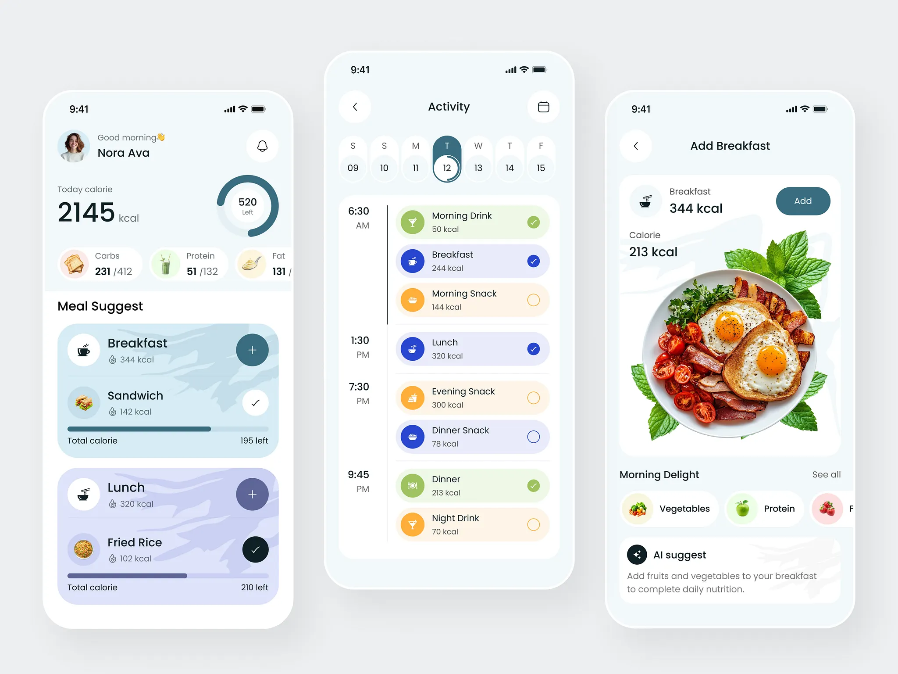
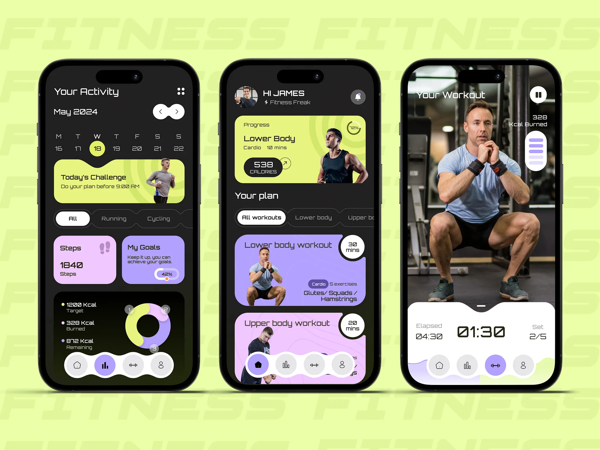

# Section 3: Screens, design system, and motion

## 3.1 Navigation

Use five persistent bottom tabs in this order:

1. **Home:** Today's summary, next action, and quick links.
2. **Workout:** Exercise library, plans, workout history, and live workout logging.
3. **Meal:** Meal plan, food search or manual entry, and daily food log.
4. **Analytics:** Progress from the user's saved records.
5. **Me:** Profile, preferences, health connections, AI and MCP connections, privacy, export, deletion, and support.

Keep the five tabs visible on the main app screens. Open detail pages inside the selected tab. Hide the tab bar only during focused tasks when it improves clarity, such as an active workout. Preserve each tab's scroll and navigation state when the user changes tabs.

The Workout tab owns the exercise library, exercise details, workout plans, workout history, and live workout logging. Keep exercise records and set logging in this tab. Do not make users open a separate Activity tab to find them.

The Me tab owns account and connection controls. Give AI and MCP connections a clear section named **AI connections**. Show provider, access scope, connection state, and revoke or disconnect action for each connection. Keep AI connections separate from health permissions and account sync.

Open an active workout as a focused full-screen flow. Keep its state when the user leaves the screen or locks the phone. A persistent active-workout control must return the user to the session.

See [Product and data diagrams](13-diagrams.md) for the navigation and record flows.

### Five-tab bar

Use five equal, labeled destinations. Use the Lucide icons `house`, `dumbbell`, `utensils`, `chart-no-axes-column`, and `user-round` for Home, Workout, Meal, Analytics, and Me.

Use the iOS tab bar: a translucent bar with a thin top line. The selected tab's icon and label take the teal tint. There is no pill (D-023). Keep inactive labels readable. Do not hide labels to fit the bar. Keep every item within the minimum touch target. Preserve each tab state when the user changes tabs. Check safe-area insets on iPhone and Android.

**Motion:** Move or fade the active indicator once. Do not bounce the whole bar. A reduced-motion setting must show the selection change immediately or with a simple color change.

## 3.2 Home screen

Home answers three questions, in order:

1. **What do I do now?** One main action: **Continue workout** when a session is active, **Start workout** on the next roadmap day when the user follows a roadmap (it starts the session at once), or **Start workout** for an empty workout.
2. **How is today's eating going?** Rings for protein, fibre, carbs, and energy (or fat when calories are hidden), against the user's targets when they are on.
3. **How is my week going?** Training days, and roadmap workouts done this week.

Then four shortcuts: Log food, Exercises, Weight calculator, and Body. Do not put detailed charts here. Link to Analytics for trends.

## 3.3 Meal tab

Use the first supplied image as a layout reference. The handbook keeps a copy below and at [Meal UI reference](references/meal-ui-reference.png).

Show a day selector, daily energy and nutrient summary, meal timeline, meal cards, and optional suggestions. Use the composition and hierarchy as inspiration. Do not use its example name, food, or nutrition values as app content.

Do not use the image's sample values as default user records.

## 3.4 Workout tab

Use the second supplied image as a layout reference. The handbook keeps a copy below and at [Workout UI reference](references/workout-ui-reference.png).

Show the exercise library, plans, training history, workout cards, and a focused live session. Use the image structure and visual energy as inspiration. Do not copy its brand, wordmark, people, or sample values.

Show pause, finish, and set-complete controls. Show set count, elapsed time, and rest time as separate values.

Do not copy names, logos, people, or branded assets from a reference image.

## 3.5 Analytics screen

Show a range selector, data summaries, and charts. Let the user open a summary to see the saved records behind it. Explain missing values and estimates.

## 3.6 Me tab and data controls

Group settings by purpose:

- Units and display.
- Goals.
- Account and sync.
- Health connections.
- AI and MCP access.
- App version, update check, release notes, and update alerts.
- Export and deletion.
- Privacy policy and support.

Do not hide data controls under a vague label such as “More.” Put update controls under **Me → Settings → App updates**. Show the installed version, latest known version, last check, release notes, and **Check for updates**. Offer a **Check automatically** control (on by default for GitHub test builds, D-029) and show a Home notice when a new version is out. Explain that the phone's installer, or the store, does the install.

## 3.7 One design system

The two references use different palettes. Use their screen layouts as references. Use one shared theme.

**Accepted style (owner, 2026-10-05):** One design system with a light and a dark mode. No purple. iOS grouped-grey canvas, white cards, deep-teal selection, lime for training energy, and four category colours (green, blue, orange, coral) for meals, muscles, and charts (owner kept these over ember, D-028). A dark ink panel holds the live workout and the exercise body model in both modes. The Meal tab follows the meal reference closely: day pills with a progress ring, a summary card, and a timeline of tinted meal pills with check circles.

Use one type style: **SF Pro** on iPhone (the system font) and **Inter** on Android and other platforms (D-023). Use the iOS text sizes: Large Title 34, Title 22, Headline 17, Body 17, Subheadline 15, Footnote 13, Caption 12. Inter uses the SIL Open Font License. Keep its license notice. Source: https://github.com/rsms/inter

Use one icon family: **Lucide**. Use a reviewed subset with one stroke and size scale. Lucide uses the ISC license. Source: https://lucide.dev/license

Do not add a separate font or palette for Meal, Workout, or Analytics. A screen can use different content and photos while it uses the same shared tokens.

### Image and asset rules

Use images when they help a user choose a food, recognize an exercise, or understand a movement. Keep decorative images out of logging controls. Resize images for their displayed size. Load optional image collections only when needed. Keep the first app download small. Record the license and source for every image, exercise diagram, font, and icon. Do not reuse the people, photos, brand, or example data in the supplied references.

## 3.8 Design tokens

Define color and size roles once. Screens must use these named roles. Do not add screen-only token sets.

### Palette

Colours live in `app/lib/core/palette.dart`. Screens read colours only from there.

| Role | Light | Dark | Use |
|---|---|---|---|
| Canvas | #F2F2F7 | #000000 | Screen background (iOS grouped background) |
| Surface | #FFFFFF | #1C1C1E | Cards and grouped lists |
| Ink | #000000 | #FFFFFF | Main text |
| Ink soft | #636366 | #98989F | Supporting text |
| Brand teal | #00727E | #40C8E0 | Tint: selection, links, main buttons (light) |
| Energy lime | #C6F432 | #C6F432 | Training actions, main buttons (dark) |
| Panel | #1C1C1E | #1C1C1E | Workout hero |
| Green / soft | #34C759 / #E3F6E7 | #30D158 / #0F2A17 | Fibre, legs, lunch |
| Blue / soft | #007AFF / #E0EEFF | #0A84FF / #0A2340 | Fat, back, breakfast |
| Orange / soft | #FF9500 / #FFF0DB | #FF9F0A / #2E1F06 | Carbs, shoulders, snacks, helper muscles |
| Coral / soft | #FF3B30 / #FFE5E3 | #FF453A / #33110F | Protein, chest, dinner |

The category colours are the iOS system colours (D-023).

`app/test/palette_test.dart` checks that every main text pair is at least 4.5:1 and every icon glyph on a category colour is at least 3:1. This is a calculated check. A rendered review on devices is still required.

### First-pass size system

- Base spacing step: 4 logical pixels.
- Common spacing: 4, 8, 12, 16, 24, and 32 logical pixels.
- Corner radii: 12, 20, and 28 logical pixels.
- Icon sizes: 20 and 24 logical pixels.
- Minimum control target: 48 logical pixels.
- Type sizes: 12, 14, 16, 20, 24, and 32 logical pixels.
- Body text: 16 logical pixels with about 24 logical pixels line height.
- Data values: use tabular figures when available.

Use SF Pro (iPhone) or Inter (Android) for every text role. Use weight and size for hierarchy. Do not add a display font for the workout screen.

These are proposed starting values. Check text scaling, translated labels, and real device layouts before treating them as final.

**Decided:** Light and dark modes, plus an Auto option that follows the system. The setting is in Me.

## 3.9 Components and states

Build shared buttons, fields, set rows, meal rows, progress rings, metric cards, date selectors, timers, permission explanations, and save states.

Each screen and reusable component must define:

- Default state.
- Pressed state.
- Disabled state.
- Loading state.
- Success state.
- Error state.
- Empty state where relevant.
- Accessibility label and focus order.

Do not build a shared component until at least two screens need the same behavior. Do not use color as the only status signal.

## 3.10 Motion principles

Motion must explain a state change, show a relationship, or confirm an action. Decorative motion must not delay logging.

- Keep motion short and purposeful.
- Do not autoplay a carousel.
- Do not use continuous shimmer after content has loaded.
- Do not use parallax, spinning, or large zoom effects in common flows.
- Do not move a field while the user enters a number.
- Do not make a user wait for an animation before the next action works.
- Keep animations interruptible.
- Stop repeating motion when the user leaves the screen.

The screen must remain clear when motion is disabled.

## 3.11 Motion tokens and behavior

Use one shared motion system. The values below are **proposed starting points**. Check them on real devices and with users before finalizing.

| Token | Starting duration | Use |
|---|---:|---|
| Motion quick | 100-140 ms | Press feedback and small state changes |
| Motion standard | 180-240 ms | Tab, card, and small panel transitions |
| Motion expanded | 240-320 ms | Opening a detail panel or bottom sheet |
| Motion chart | 180-260 ms | One-time chart update after data changes |

Use an ease-out curve when an item enters. Use an ease-in curve when it leaves. Use a standard curve for a value change. Keep one curve family across the app.

### Required motion map

| Event | Motion | Rule |
|---|---|---|
| Tab change | Move or fade the active indicator once | Keep the selected tab clear and labels visible |
| Open live workout | Use a short focused transition | Keep the timer and session state live |
| Add a set | Insert row and show a brief saved confirmation | Keep focus in the next useful field |
| Complete a set | Check mark and brief surface highlight | Do not delay the next set |
| Start rest timer | Timer ring begins from its actual remaining time | Timer remains readable without animation |
| Add a meal | Insert the card and update totals once | Do not animate calorie precision |
| Update a progress ring | Animate from old value to new value once | Announce the value to screen readers |
| Change chart range | Update chart once with a short transition | Keep the selected range visible |
| Connect or revoke access in Me | Update the connection row after the result | Never show success before access changes |
| Finish workout | Show a short summary transition | No forced confetti or full-screen effect |

Do not show a success animation before the local save succeeds. If saving fails, show the error state.

## 3.12 Reduced motion, haptics, and sound

Read the operating system's reduced-motion setting. Replace non-essential movement with a dissolve, color change, or immediate state change. Preserve motion only when it explains an important state, and provide a low-motion form.

Do not require sound. Keep sound effects off by default.

Use haptics only for clear events, such as a completed set, if the platform supports them. Do not vibrate on every number tap. Respect system settings and provide an app control if repeated haptics are added.

Apple advises developers to adapt motion that can cause discomfort. Flutter documents animation tools and performance checks. Sources: https://developer.apple.com/design/human-interface-guidelines/motion/ and https://docs.flutter.dev/ui/animations

## 3.13 Animation performance

Test animations in optimized profile or release builds on target devices. Use Flutter DevTools to inspect slow frames and unnecessary rebuilds.

At 60 frames per second, one frame has about 16.7 ms. At 120 frames per second, one frame has about 8.3 ms. These are frame budgets, not guaranteed app targets.

**To confirm:** Supported devices, refresh rates, and the acceptable slow-frame rate. Record the device and build for every measurement.

Avoid rebuilding a large screen for each animation tick. Do not animate large images or blur surfaces without profiling. Flutter's performance guidance describes common costs for opacity, clipping, and repeated widget work. Source: https://docs.flutter.dev/perf/best-practices

## 3.14 Accessibility and motion review

- Label every icon-only action for screen readers.
- Support large text and device text scaling.
- Keep workout controls easy to tap with one hand.
- Keep focus order logical after adding or deleting a row.
- Announce saved, failed, and completed states.
- Respect reduced motion.
- Test with VoiceOver and TalkBack.
- Test motion and focus on a real phone, not only a simulator.

## 3.14.1 Exercise demos and body icons

Library photos play as one slow rep: a pause at the start, 1.5 s to the end position, a pause, and 2.5 s back. A label names each phase. The user can pause, play at half speed, or drag a slider between the start and end photos. With reduced motion the rep does not play; the slider still works.

Each body area and muscle has a drawn body icon that colours only that part. Exercise pages show a front and back body map with main and helper muscles.

### Coached body model

Each built-in exercise has an animated 3D body model. It is a drawn mannequin, not a video. The user can drag to turn it to any angle, pick Front, Side, 3/4, or Back, pause, play at half speed, and show live joint-angle labels. Main muscles glow lime. Helper muscles glow orange. The model starts paused when the system asks to reduce motion.

## 3.15 Visual quality gate

Before a screen is ready for release:

1. Compare it with the approved screen flow.
2. Check spacing, alignment, type, and color against shared tokens.
3. Check loading, empty, error, saved, disabled, and offline states.
4. Check large text and screen-reader behavior.
5. Check screenshots on a small phone and a large phone.
6. Check image and icon licenses.
7. Check that motion does not block input.
8. Record any visual difference that is intentional.

Do not accept a screen because it looks good in one simulator size. Test it on real devices.

### Update notice behavior

Check for update metadata after launch and when the app returns to the foreground. Cache the result and avoid repeated checks. Show an in-app notice when the installed version is behind. Do not interrupt a workout or meal log.

On Android, use Google Play in-app updates when the app came from Google Play. Use the flexible flow for normal releases. Use the immediate flow only for a critical update that blocks safe or essential use.

On iPhone, open the app's App Store page. The user must start the update in the App Store. Do not claim that the app can install an iOS binary itself.

Send push update alerts only to users who turn them on and grant system notification permission. If they decline push, keep the in-app update notice and the Settings check available.

## 3.17 AI context

- **Purpose:** Define screen behavior, shared appearance, and motion.
- **Navigation:** Home, Workout, Meal, Analytics, Me.
- **Workout tab:** Exercise library, plans, workout history, and live logging.
- **Me tab:** Account, sync, health, AI and MCP connections, privacy, export, and deletion.
- **Reference mapping:** Image 1 informs Meal layout. Image 2 informs Gym layout.
- **Theme:** One shared design system and one token set.
- **Font:** SF Pro on iPhone, Inter elsewhere (D-023). **Icons:** Reviewed Lucide set.
- **Motion:** Explain changes. Never block logging. Respect reduced motion.
- **Do not:** Treat image sample values as records or add motion only for decoration.
- **To confirm:** Exact tokens, durations, target devices, and minimum operating-system versions.
- **Motion quality:** Give each core action a crafted response. Keep transitions brief, consistent, interruptible, and non-blocking. Do not animate every component on every screen entry.
