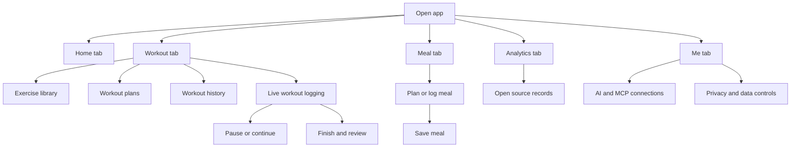
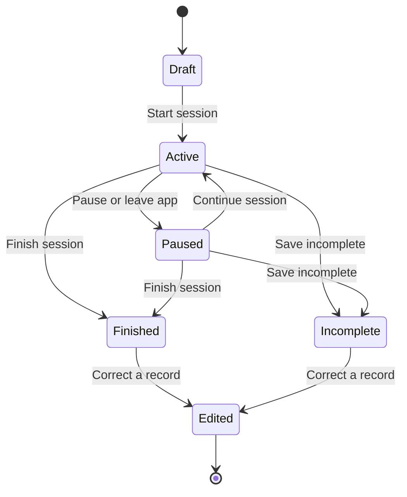
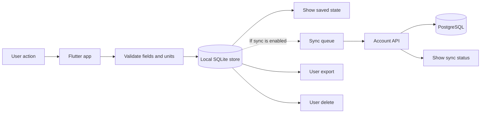
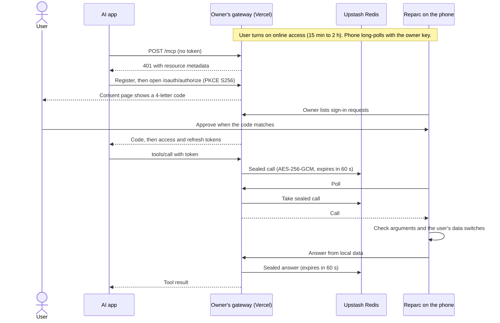
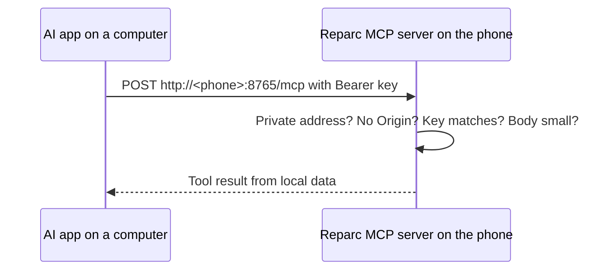
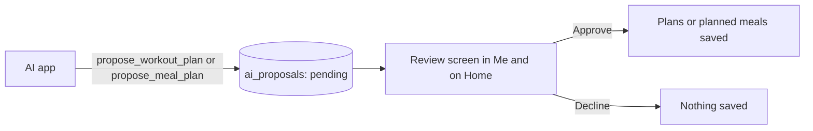
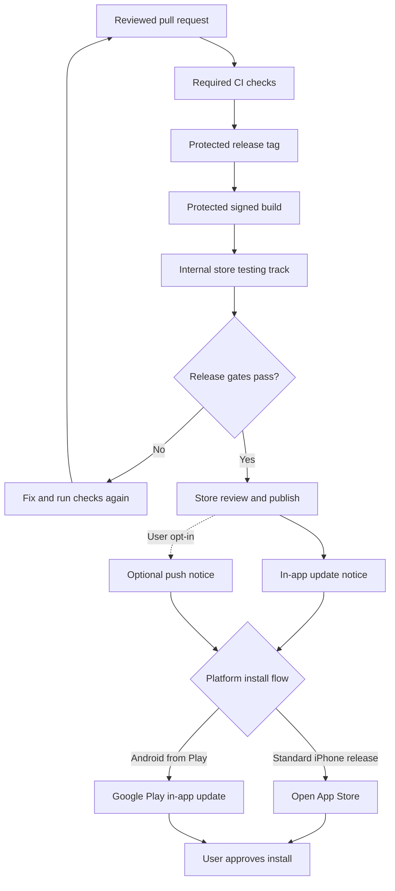

# Product and data diagrams

These diagrams describe planned behavior. They do not show implemented code. Keep them aligned with the source chapters.

## 1. Main navigation

## 2. Workout session states

A session must not disappear when the app closes. Save each valid set locally.

## 2a. Guided workout flow (handbook 4.13)

With both **Run on its own** switches on (the default), no tap is needed after **Start workout**. Every time comes from Me → Workout guide.

```mermaid
flowchart LR
    Start([Start workout]) --> W1[Warm-up move 1]
    W1 -->|no rest| W2[Warm-up move 2 ... last]
    W2 --> WR[Rest after warm-up]
    WR --> S1[Set 1]
    S1 --> R1[Rest between sets]
    R1 --> S2[Set 2]
    S2 --> R2[Rest between sets]
    R2 --> S3[Set 3]
    S3 --> R3[Rest] --> Next[Next exercise: set 1, rest, set 2, rest, set 3]
    Next --> Done([Every set done: user finishes and saves])
```

## 3. Local-first record flow

A local save must finish before sync starts. An offline or failed sync must not block workout or meal entry.

## 4. MCP data paths (D-018, D-019)

Online, through the owner's own gateway:

On the same Wi-Fi:

Plan proposals:

The AI app receives the answers it asks for. The app explains this before the user connects. Removing an app in Reparc stops its later requests at once. The gateway keeps no records.

## 5. Product lifecycle

```mermaid
flowchart LR
    Research[Research] --> Validate[Internal screen validation]
    Validate --> Foundation[Production foundation]
    Foundation --> Alpha[Private production alpha]
    Alpha --> Sync[Optional sync]
    Sync --> Health[Health access]
    Health --> MCP[MCP pilot]
    MCP --> Release[Public release]
    Release --> Operate[Support and updates]
    Operate --> Retire[Feature end-of-life]
```

A later stage can be skipped only when the product owner records the reason. Optional sync, health access, and MCP are not required for the first release.

## 6. Production release and update flow

GitHub starts a controlled release. The app gets update information from the store or a data-only release manifest. The store installs the app binary.

Do not send notices for a branch push or an unpublished store build. Do not install executable code from GitHub.

## AI context

- **Purpose:** Give humans and AI agents a shared view of major flows.
- **Source:** Follow the detailed rules in the linked feature chapters.
- **Rule:** Update a diagram when its source flow changes.
- **Rule:** Do not treat a diagram as evidence that code exists.
- **Rule:** Update releases follow the store flow in [Production readiness and app updates](16-production-and-app-updates.md).
- **Rule:** Keep local records available when remote services fail.
